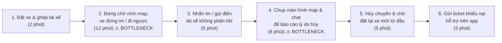
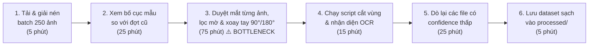
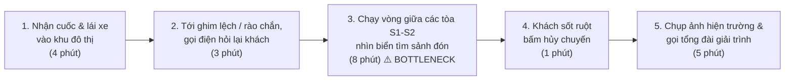

# Báo cáo cá nhân — 2A202603475_LyThanhLam

> Đổi tên file theo quy tắc `MSSV_HoTen.md`, ví dụ `20241234_NguyenVanAn.md` (MSSV trước, dấu `_`, họ tên viết liền không dấu). Sửa cả dòng tiêu đề phía trên cho khớp.
> Template chi tiết và prompt mẫu cho từng mục: [docs/01-worksheet.md](../../docs/01-worksheet.md).
> Mỗi thành viên một file trong `report/individual/` trên repo nhóm: copy template này thành file mới, điền, rồi commit bằng tài khoản GitHub của bạn. Không viết hộ người khác.

## 1. Thông tin học viên

- Họ tên: Lý Thanh Lâm
- MSSV: 2A202603475
- Email trường: 26ai.lamlt@vinuni.edu.vn
- Tên nhóm: Ban3
- Link repo nhóm: https://github.com/LysLama/K5-L3A-DAY02-Ban3-DiscoveryProblemFraming

---

## 2. Scan problem (CP1)

Lăng kính: **Lặp lại** · **Tốn thời gian** · **Cần đọc, tổng hợp nhiều thông tin** · **Pain từ người khác**.

|  # | Lăng kính                              | Job Story: Khi… tôi muốn… để…                                                                                                                                                                                                                                                                                                                                                                                                                        | Ai chịu ảnh hưởng?                                                                                                     | Dấu hiệu thật (thời gian, tần suất, số người, bằng chứng)                                                                                                                                                                                                                                                                                                                                                                                                            |
| -: | ---------------------------------------- | ----------------------------------------------------------------------------------------------------------------------------------------------------------------------------------------------------------------------------------------------------------------------------------------------------------------------------------------------------------------------------------------------------------------------------------------------------------- | -------------------------------------------------------------------------------------------------------------------------- | ------------------------------------------------------------------------------------------------------------------------------------------------------------------------------------------------------------------------------------------------------------------------------------------------------------------------------------------------------------------------------------------------------------------------------------------------------------------------------- |
|  1 | Lặp lại                                | Khi đặt xe Xanh SM Bike hoặc Taxi mà gặp tình trạng tài xế nhận cuốc nhưng không muốn đi nên đứng yên một chỗ hoặc đi ngược hướng để "ngâm cuốc" đợi khách tự hủy, tôi muốn hệ thống ghi nhận trạng thái di chuyển bất thường để hỗ trợ đổi tài xế khác hoặc hủy chuyến không tính phí ngay lập tức, để không bị mất 30–60 phút chờ đợi vô ích và không bị trễ công việc. | Hành khách đặt xe (sinh viên, người đi làm), các tài xế chạy nghiêm túc xung quanh                          | Bản thân từng gặp 3–4 lần khi đặt xe từ khu vực Vinhomes Ocean Park sang Aeon Mall Long Biên (kể cả giờ bình thường lẫn cao điểm); mỗi lần phải đợi 15–30 phút tài xế vẫn đứng im trên bản đồ, nhắn tin không trả lời, phải tự bấm hủy đặt lại và tốn thêm 10 phút chụp màn hình báo cáo.                                                                                                                               |
|  2 | Lặp lại                                | Khi chuẩn bị commit và nộp bài tập lab lên repository chung của nhóm trước hạn nộp, tôi muốn đối soát nhanh danh sách các file nộp, quy tắc đặt tên và cấu trúc thư mục với rubric môn học, để không bị trừ điểm oan do đặt sai tên file hoặc thiếu mục bắt buộc.                                                                                                                                           | Sinh viên (bản thân và các thành viên trong nhóm), Teaching Assistant chấm bài                                   | Qua các bài lab liên tiếp và các đợt nộp đồ án trước đây, mỗi lần trước khi push bài đều mất 20–30 phút kiểm tra thủ công từng tên file (`MSSV_HoTen.md`), dấu gạch dưới (`_`) và các quy tắc format trong `SUBMISSION.md` để đảm bảo không làm sai gây mất 5 điểm phạt định dạng.                                                                                                                                   |
|  3 | Lặp lại                                | Khi chuyển đổi giữa máy tính cá nhân và môi trường máy trạm hoặc Google Colab để chạy thực nghiệm mô hình hàng tuần, tôi muốn đồng bộ ngay danh sách thư viện (dependencies), biến môi trường và cấu hình đường dẫn dữ liệu, để bắt tay vào chạy code ngay mà không phải cài đặt và sửa lỗi thiếu gói lặp đi lặp lại.                                                                      | Sinh viên, lập trình viên làm dự án AI theo nhóm (3–4 người/nhóm)                                              | Trung bình 2–3 lần/tuần khi kéo code từ repo về máy hoặc mở phiên làm việc mới đều mất 20–30 phút cài lại môi trường ảo (`venv`), xử lý lỗi lệch phiên bản thư viện (`pydantic`, `torch`, SDK) và sửa lại đường dẫn file trước khi chạy được script.                                                                                                                                                                        |
|  4 | Tốn thời gian                          | Khi gom dữ liệu dataset thật về để huấn luyện cũng như kiểm thử OCR trên các bản vẽ và tài liệu scan thực tế, tôi muốn lọc nhanh các ảnh bị mờ và xoay phẳng các ảnh bị chụp nghiêng hoặc ngược chiều trước khi đưa vào pipeline, để tiết kiệm hàng giờ ngồi kiểm tra và căn chỉnh thủ công từng file.                                                                                            | Sinh viên, Data Scientist / AI Engineer                                                                                   | Bản thân mỗi khi làm dự án mới hoặc cập nhật đợt dữ liệu mới (khoảng 200–300 bản vẽ/tài liệu scan) đều mất 2–3 giờ ngồi xem lại toàn bộ dữ liệu xem có đồng nhất với đợt trước để áp dụng script hàng loạt hay không; nếu lệch góc chụp hoặc mờ đều phải lọc và xoay lại bằng tay.                                                                                                                                 |
|  5 | Tốn thời gian                          | Khi nhận tài liệu đề bài hackathon hoặc đặc tả yêu cầu dự án/bài lab dài hàng chục trang với nhiều quy tắc chấm điểm và ràng buộc kỹ thuật, tôi muốn nắm bắt nhanh sơ đồ luồng dữ liệu (data flow) và danh sách đầu ra bắt buộc ở từng mốc, để cả nhóm thống nhất cách triển khai ngay từ đầu mà không bị hiểu lệch hướng.                                                                | Các thành viên trong nhóm làm dự án / bài lab (3–4 học viên)                                                    | Mỗi khi bắt đầu buổi lab dài hoặc nhận tài liệu dự án mới (gồm 5–6 file hướng dẫn như `README`, `RULES`, `CHECKPOINTS`, `RUBRIC`), cả nhóm mất 45–60 phút đầu giờ chỉ để đọc chéo và tranh luận xem yêu cầu đầu ra thực sự ở từng mục là gì do mỗi người đọc và hiểu một kiểu.                                                                                                                                   |
|  6 | Cần đọc, tổng hợp nhiều thông tin | Khi gặp lỗi xung đột phiên bản thư viện hoặc lỗi kết nối API lúc tích hợp các module code, tôi muốn đối chiếu nhanh thông báo lỗi (stack trace) với lịch sử thay đổi phiên bản (changelog) và các thảo luận cách sửa lỗi tương thích, để tìm ra nguyên nhân gốc mà không bị lạc giữa hàng chục trang thảo luận cũ.                                                                                 | Lập trình viên / học viên trực tiếp viết và tích hợp code                                                       | Trong quá trình tích hợp SDK gọi mô hình ngôn ngữ và bộ kiểm thử tự động vừa qua, bản thân phải mở cùng lúc 12–15 tab GitHub Issues, StackOverflow và tài liệu API chính thức trong suốt hơn 1 tiếng chỉ để phát hiện một tham số cấu hình không được hỗ trợ ở bản `v1` mà bắt buộc phải khai báo `v1beta`.                                                                                                           |
|  7 | Cần đọc, tổng hợp nhiều thông tin | Khi bắt đầu một bài tập lớn hoặc đồ án môn học với danh mục 12–15 bài báo khoa học (papers) về VLM, OCR hoặc RAG, tôi muốn trích xuất và đặt cạnh nhau kiến trúc mô hình, các phương pháp đánh giá (evaluation metrics) và tập dữ liệu benchmark đã dùng, để thiết kế thí nghiệm đối chuẩn mà không bị sót phương pháp.                                                                      | Sinh viên nghiên cứu, thành viên nhóm làm đồ án AI                                                               | Tốn khoảng 3–4 tiếng mỗi đợt khảo sát tài liệu để đọc lướt các file PDF từ arXiv và gõ tay bảng so sánh vào Notion; ghi chú thường bị phân mảnh và mất thêm 30 phút mỗi lần phải mở lại từng PDF để tra nguồn công thức gốc hoặc điều kiện benchmark.                                                                                                                                                                         |
|  8 | Cần đọc, tổng hợp nhiều thông tin | Khi khảo sát đánh giá của người dùng thực tế về một dịch vụ (như ứng dụng đặt xe hoặc tiện ích nội khu) trên các hội nhóm Facebook và mục review Google Play / App Store để làm bài tập nhóm, tôi muốn gom hàng trăm bình luận rời rạc thành các cụm vấn đề bị phàn nàn nhiều nhất, để rút ra bằng chứng thực tế mà không phải đọc và phân loại thủ công.                           | Học viên thực hiện phần nghiên cứu người dùng (User Research) trong nhóm                                        | Khi tìm kiếm phản hồi thực tế của hành khách và tài xế trên các group cộng đồng và kho ứng dụng để chuẩn bị dẫn chứng cho bài tập khám phá vấn đề, tôi đã mất hơn 1,5 tiếng cuộn đọc khoảng 150–200 bình luận xen lẫn spam và phải copy-paste thủ công từng ý vào bảng tổng hợp.                                                                                                                                       |
|  9 | Pain từ người khác                   | Khi khách hàng đặt xe tại các khu đô thị nhiều tòa nhà (như phân khu Sapphire S1, S2 Vinhomes Ocean Park) nhưng điểm ghim định vị trên bản đồ bị lệch sang sảnh khác hoặc vướng phân luồng nội khu khiến thời gian đón kéo dài, người tài xế muốn gửi nhanh vị trí thực tế và lý do khách quan cho khách và hệ thống, để không bị khách hủy chuyến oan hoặc bị đánh giá chậm trễ.    | Tài xế xe công nghệ (Xanh SM, Grab, Be) đón trả khách quanh khu vực khu đô thị, hành khách đứng chờ       | Trò chuyện trực tiếp với 2 tài xế Xanh SM trên các chuyến xe đi học quanh khu vực Vinhomes Ocean Park tuần qua: cả 2 bác tài đều chia sẻ việc ghim bản đồ ở các tòa S1–S2 thường lệch sảnh đón khiến tài xế mất 8–12 phút chạy vòng tìm khách mà không được tính thêm cước; nếu khách sốt ruột hủy chuyến, tài xế lại mất công gọi tổng đài giải trình để không bị trừ tỷ lệ hoàn thành chuyến. |
| 10 | Pain từ người khác                   | Khi đưa xe vào khu vực trạm sạc tại nhà để xe nổi nhiều tầng hoặc bãi đỗ xe nội khu Vinhomes Ocean Park vào giờ cao điểm mà các trụ sạc đều bị chiếm chỗ bởi xe đã sạc đầy 100% nhưng chủ xe chưa ra rút súng sạc, người lái xe đang chờ muốn có cơ chế thông báo nhắc chủ xe trước di chuyển kịp thời, để có trụ sạc ngay mà không phải xếp hàng chờ vô định.                   | Tài xế chạy dịch vụ và cư dân sử dụng xe điện chờ sạc (trung bình 3–5 xe chờ vào khung giờ chiều tối) | Quan sát thực tế 3 buổi chiều tối tại khu vực trạm sạc nhà để xe nổi nhiều tầng (gần Vincom Mega Mall Ocean Park) và bãi đỗ xe phân khu Sapphire: thường xuyên thấy 3–4 xe điện bật đèn cảnh báo xếp hàng chờ, trong khi màn hình 2 trụ sạc bên trong đã báo đầy 100% từ 30–40 phút trước mà chủ xe chưa quay lại lấy xe.                                                                                              |

**Nếu có dùng AI để gợi ý thêm:** ý nào AI gợi ý mà bạn giữ lại, ý nào bỏ và vì sao.

- **Ý kiến AI gợi ý được giữ lại và viết lại theo trải nghiệm thật:**
  - *Ý #6 (Đối chiếu lỗi xung đột thư viện và API khi tích hợp code):* AI gợi ý chung chung là "làm công cụ AI tự động sửa mọi bug". Tôi đã bỏ lối viết giải pháp đó và viết lại dựa trên trải nghiệm thật khi làm thực hành: mất hơn 1 tiếng mở 12–15 tab GitHub Issues và tài liệu để tìm ra lỗi khác biệt phiên bản API `v1` và `v1beta`.
  - *Ý #2 (Rà soát quy tắc đặt tên file và rubric trước khi nộp bài lab):* AI gợi ý "hệ thống AI tự động chấm bài tập". Tôi đã thu hẹp và viết lại đúng với việc nhóm mình làm thực tế: mất 20–30 phút kiểm tra thủ công từng tên file (`MSSV_HoTen.md`) và cấu trúc thư mục theo `SUBMISSION.md` để tránh mất điểm phạt.
- **Ý kiến AI gợi ý bị loại bỏ hoàn toàn:**
  - *Gợi ý "Đóng vai Quản lý đội xe (Fleet Manager), Kỹ thuật viên xưởng dịch vụ hoặc CSKH nội bộ":* Ban đầu AI sinh ra các kịch bản nội bộ như phân loại mã lỗi DTC xưởng dịch vụ hay quản lý 150 ticket CSKH. Tôi đã loại bỏ hoàn toàn vì bản thân là học viên, không trực tiếp làm các vị trí vận hành nội bộ đó nên các con số đều là suy diễn, không có bằng chứng thật.
  - *Gợi ý "Chatbot tự động an ủi khách hàng khi tài xế ngâm cuốc":* Bị loại vì đây là giải pháp trá hình (solution-in-disguise) và không giải quyết được nhu cầu thật của hành khách lúc đang vội là cần đổi xe mới đi ngay hoặc hủy chuyến không mất phí.

---

## 3. Top 3 Problem Cards + quy trình nháp (CP2)

### Bảng chọn top 3

| Rank | Problem                                                                                                                                            | Vì sao chọn                                                                                                                                                                                   | Điều còn chưa chắc                                                                                                                                                                                                                                                        |
| ---: | -------------------------------------------------------------------------------------------------------------------------------------------------- | ----------------------------------------------------------------------------------------------------------------------------------------------------------------------------------------------- | ------------------------------------------------------------------------------------------------------------------------------------------------------------------------------------------------------------------------------------------------------------------------------ |
|    1 | Tài xế Xanh SM nhận chuyến nhưng đứng yên/đi ngược hướng "ngâm cuốc" đợi khách tự hủy (#1)                                     | Nỗi đau trực tiếp, lặp lại nhiều lần với cả mình và bạn bè; quy trình phía người dùng rất rõ từng bước; so sánh được rành mạch giữa Rule-based và AI Workflow.  | Làm sao phân biệt chính xác giữa tài xế cố tình "ngâm cuốc" với tài xế bị kẹt cứng tại nút giao thông/rào chắn đột xuất? Ngoài ra nhóm không có quyền truy cập DB nội bộ của hãng nên cần xác định rõ phạm vi dữ liệu mô phỏng. |
|    2 | Lọc ảnh mờ và xoay phẳng các bản vẽ/tài liệu scan bị nghiêng trước khi đưa vào pipeline OCR (#4)                                  | Đúng chuyên môn kỹ thuật AI/Data của bản thân; bottleneck đo được chính xác bằng số phút ngồi duyệt tay trên từng batch 200–300 ảnh; dữ liệu hoàn toàn chủ động. | Với các bản vẽ kỹ thuật có nhiều ký hiệu đặc thù và ít dòng chữ ngang, mô hình phân loại góc xoay tự động có đạt độ chính xác cao hơn thuật toán xử lý ảnh cổ điển không?                                                            |
|    3 | Lệch điểm ghim đón khách giữa các tòa nhà (khu S1, S2 Vinhomes Ocean Park) khiến tài xế tìm sảnh lâu và dễ bị hủy chuyến (#9) | Có bằng chứng thực tế từ cuộc trò chuyện trực tiếp với các bác tài Xanh SM quanh trường; quy trình và bước nghẽn (chạy vòng tìm sảnh) rất cụ thể.                  | Liệu bài toán này chỉ cần giải bằng thiết kế UX/Rule (danh sách điểm đón cố định theo từng tòa) là đủ, hay có thực sự cần đến AI?                                                                                                                 |

### Problem Card #1 — Xử lý tình trạng tài xế "ngâm cuốc" khi đặt xe (#1)

| Trường                                        | Nội dung                                                                                                                                                                                                                                                                                                                                                                                                                                                                                                                                                                                                                                                                                                                                                                                                                                                                                                                                                      |
| ----------------------------------------------- | -------------------------------------------------------------------------------------------------------------------------------------------------------------------------------------------------------------------------------------------------------------------------------------------------------------------------------------------------------------------------------------------------------------------------------------------------------------------------------------------------------------------------------------------------------------------------------------------------------------------------------------------------------------------------------------------------------------------------------------------------------------------------------------------------------------------------------------------------------------------------------------------------------------------------------------------------------------- |
| Job Story                                       | Khi đặt xe Xanh SM Bike hoặc Taxi mà gặp tình trạng tài xế nhận cuốc nhưng không muốn đi nên đứng yên một chỗ hoặc đi ngược hướng để "ngâm cuốc" đợi khách tự hủy, tôi muốn hệ thống ghi nhận trạng thái di chuyển bất thường để hỗ trợ đổi tài xế khác hoặc hủy chuyến không tính phí ngay lập tức, để không bị mất 30–60 phút chờ đợi vô ích và không bị trễ công việc.                                                                                                                                                                                                                                                                                                                                                                                                                                                                                                    |
| Actor                                           | Hành khách đặt xe qua ứng dụng Xanh SM (sinh viên, người đi làm di chuyển tuyến Vinhomes Ocean Park – Long Biên/nội thành).                                                                                                                                                                                                                                                                                                                                                                                                                                                                                                                                                                                                                                                                                                                                                                                                                   |
| Thời điểm / bối cảnh                       | Khi đặt xe trên ứng dụng (đặc biệt vào giờ giao ca, giờ cao điểm hoặc trời mưa, quãng đường nhỡ cỡ), hệ thống đã ghép tài xế thành công nhưng xe không di chuyển về phía điểm đón.                                                                                                                                                                                                                                                                                                                                                                                                                                                                                                                                                                                                                                                                                                                                     |
| Quy trình hiện tại (3–7 bước)             | 1. Khách đặt xe trên app, áp mã giảm giá và được hệ thống ghép tài xế thành công (2 phút) 2. Khách theo dõi bản đồ, thấy xe đứng im một chỗ hoặc chạy ngược hướng suốt thời gian dài mà không tiến về điểm đón (12 phút)  3. Khách nhắn tin qua chat trong app và gọi điện hỏi tài xế nhưng tài xế không bắt máy hoặc trả lời vòng vo "đang kẹt/đợi chút" để ép khách tự hủy (5 phút) 4. Khách muốn hủy chuyến nhưng sợ mất mã giảm giá hoặc bị tính phí hủy, phải chụp màn hình vị trí xe ở các mốc thời gian và lịch sử chat để làm bằng chứng báo cáo lý do hủy (8 phút) 5. Khách bấm hủy chuyến và phải chờ hệ thống quét tìm lại tài xế mới từ đầu (5 phút) 6. Khách gửi ticket phản ánh lên mục Hỗ trợ trong app nếu bị mất voucher hoặc bức xúc vì trễ giờ (3 phút). |
| Bottleneck (bước nào, mất bao nhiêu phút) | **Bước 2 và Bước 4 (tổng cộng 20 phút):** Khách bị kẹt ở thế bị động suốt 12 phút nhìn bản đồ chờ xác nhận xem tài xế tắc đường thật hay cố tình "ngâm cuốc", cộng thêm 8 phút tự chụp màn hình lộ trình hoặc tin nhắn làm bằng chứng để hủy chuyến mà không bị mất quyền lợi.                                                                                                                                                                                                                                                                                                                                                                                                                                                                                                                                                                                                               |
| Impact (nếu không giải thì sao)             | Mỗi lần gặp tài xế "ngâm cuốc", hành khách mất trắng 25–35 phút đứng chờ trong bức xúc, bị trễ giờ học, công việc, làm giảm niềm tin vào ứng dụng và khiến khách chuyển sang gọi xe hãng khác.                                                                                                                                                                                                                                                                                                                                                                                                                                                                                                                                                                                                                                                                                                                           |
| Success metric (baseline → target)             | **Baseline:** Thời gian từ lúc tài xế nhận cuốc nhưng không di chuyển đến khi khách đổi được xe mới, hủy hợp lệ không mất voucher hiện mất trung bình **25–35 phút** (qua 3–4 lần gặp thực tế). **Target:** Giảm thời gian phát hiện và cho phép khách bấm "Đổi tài xế mới / Hủy miễn phí (giữ nguyên ưu đãi)" xuống **dưới 5 phút**; khách không phải tự chụp màn hình giải trình thủ công. **Cách đo:** Đo thời gian từ lúc xe có dấu hiệu đứng im, đi ngược hướng sau khi nhận cuốc đến lúc hệ thống kích hoạt quyền đổi xe miễn phí trên màn hình khách hàng.                                                                                                                                                                                                                                           |
| Phương án không dùng AI                    | **Rule-based (Tập luật ngưỡng thời gian & khoảng cách):** Nếu sau 3 phút kể từ khi nhận cuốc mà khoảng cách GPS từ xe tới điểm đón không giảm (hoặc tăng lên >300m) VÀ khu vực đó không có cảnh báo tắc đường đỏ VÀ tài xế không phản hồi tin nhắn $\rightarrow$ tự động hiển thị nút "Đổi tài xế khác (giữ nguyên giá & ưu đãi)" cho khách.                                                                                                                                                                                                                                                                                                                                                                                                                                                                                                                                         |
| Giả thuyết về AI (nếu có)                  | Kết hợp bước **AI Workflow** khi cần phân tích ngữ cảnh đoạn chat/gợi ý hủy chuyến giữa tài xế và khách (ví dụ tài xế nhắn tin bóng gió bảo khách hủy giúp hoặc báo hỏng xe) kết hợp dữ liệu vết GPS và trạng thái giao thông để phân loại chính xác giữa "cố tình ngâm cuốc" và "sự cố khách quan", hỗ trợ bộ phận vận hành hậu kiểm công bằng mà không phạt oan tài xế.                                                                                                                                                                                                                                                                                                                                                                                                                                                                                                       |
| Cảm nhận nhanh                                | **Rule** (cho bước giải cứu khách hàng tức thời) kết hợp **Workflow** (cho bước tổng hợp bằng chứng phân loại khiếu nại).                                                                                                                                                                                                                                                                                                                                                                                                                                                                                                                                                                                                                                                                                                                                                                                                      |

Quy trình nháp hiện tại:

### Problem Card #2 — Lọc ảnh mờ và xoay phẳng bản vẽ/tài liệu scan bị nghiêng cho pipeline OCR (#4)

| Trường                                        | Nội dung                                                                                                                                                                                                                                                                                                                                                                                                                                                                                                                                                                                                                                                                                                                                                                                                                                              |
| ----------------------------------------------- | ------------------------------------------------------------------------------------------------------------------------------------------------------------------------------------------------------------------------------------------------------------------------------------------------------------------------------------------------------------------------------------------------------------------------------------------------------------------------------------------------------------------------------------------------------------------------------------------------------------------------------------------------------------------------------------------------------------------------------------------------------------------------------------------------------------------------------------------------------ |
| Job Story                                       | Khi gom dữ liệu dataset thật về để huấn luyện cũng như kiểm thử OCR trên các bản vẽ và tài liệu scan thực tế, tôi muốn lọc nhanh các ảnh bị mờ và xoay phẳng các ảnh bị chụp nghiêng hoặc ngược chiều trước khi đưa vào pipeline, để tiết kiệm hàng giờ ngồi kiểm tra và căn chỉnh thủ công từng file.                                                                                                                                                                                                                                                                                                                                                                                                                                                                                       |
| Actor                                           | Sinh viên / kỹ sư AI trực tiếp chuẩn bị dữ liệu và xây dựng pipeline nhận diện văn bản (OCR).                                                                                                                                                                                                                                                                                                                                                                                                                                                                                                                                                                                                                                                                                                                                          |
| Thời điểm / bối cảnh                       | Mỗi khi bắt đầu dự án mới hoặc nhận một lô (batch) 200–300 ảnh chụp bản vẽ kỹ thuật, hóa đơn, tài liệu scan thực tế từ nhiều nguồn khác nhau để đưa vào huấn luyện và đánh giá mô hình.                                                                                                                                                                                                                                                                                                                                                                                                                                                                                                                                                                                                                      |
| Quy trình hiện tại (3–7 bước)             | 1. Tải thư mục ảnh thô (khoảng 250 file `.jpg`, `.png`, `.pdf`) về máy và giải nén (5 phút) · 2. Mở trình xem ảnh duyệt qua bố cục để xem đợt dữ liệu mới có giống đợt trước nhằm tái sử dụng script cũ không (25 phút) · 3. Duyệt thủ công từng ảnh bằng mắt để lọc bỏ ảnh mờ nhòe và bấm xoay lại (90°, 180° hoặc căn chỉnh góc nghiêng) cho khoảng 50–60 ảnh bị chụp lệch/ngược (75 phút) · 4. Chạy script cắt vùng văn bản (bounding box) và đưa qua mô hình OCR trích xuất text (15 phút) · 5. Đối chiếu kết quả OCR ở các file có điểm tự tin (confidence) thấp với ảnh gốc xem lỗi do mô hình hay do ảnh vẫn còn nghiêng/bóng (25 phút) · 6. Lưu bộ dữ liệu đã làm sạch vào thư mục `processed/` (5 phút). |
| Bottleneck (bước nào, mất bao nhiêu phút) | **Bước 3 (75 phút):** Ngồi mở duyệt từng ảnh bằng mắt thường để tách ảnh mờ và bấm xoay/căn chỉnh lại các bản vẽ, tài liệu bị chụp nghiêng hoặc lộn ngược 90°/180° trước khi chạy OCR.                                                                                                                                                                                                                                                                                                                                                                                                                                                                                                                                                                                                                    |
| Impact (nếu không giải thì sao)             | Tốn 2–2,5 giờ làm việc thủ công nhàm chán cho mỗi đợt cập nhật dữ liệu; nếu duyệt vội để sót ảnh nghiêng/ngược đưa vào pipeline thì mô hình OCR nhận diện sai hàng loạt, làm lệch kết quả đánh giá và mất thêm hàng giờ debug nhầm vào mô hình.                                                                                                                                                                                                                                                                                                                                                                                                                                                                                                                                                    |
| Success metric (baseline → target)             | **Baseline:** Mất trung bình **100 phút** (Bước 2 + Bước 3) để kiểm tra và xoay/lọc thủ công cho mỗi batch 250 ảnh; tỷ lệ ảnh nghiêng/ngược bị sót khoảng 5–8%.**Target:** Giảm thời gian kiểm tra và chuẩn hóa hướng ảnh cho batch 250 ảnh xuống **dưới 15 phút** (chỉ duyệt lại các ảnh máy báo độ tự tin thấp); tỷ lệ ảnh sai hướng lọt vào OCR **< 1%**.**Cách đo:** Bấm giờ thời gian xử lý thực tế trên cùng một batch 250 ảnh tài liệu hỗn hợp và đếm số ảnh còn bị ngược/nghiêng sau khi chạy.                                                                                                                                                                                                                       |
| Phương án không dùng AI                    | Dùng thuật toán xử lý ảnh cổ điển (**OpenCV Rule-based**): tính phương sai Laplacian (Laplacian variance) để lọc ảnh mờ và dùng phép biến đổi Hough (Hough Transform) để căn chỉnh góc nghiêng nhỏ (±15°). Tuy nhiên cách này không phát hiện được ảnh bị chụp lộn ngược 180° hoặc bản vẽ kỹ thuật có nhiều đường kẻ chéo.                                                                                                                                                                                                                                                                                                                                                                                                                                                           |
| Giả thuyết về AI (nếu có)                  | Xây dựng **Workflow tiền xử lý tự động**: kết hợp Rule (Laplacian lọc ảnh mờ) + mô hình phân loại hướng tài liệu nhẹ (như Document Orientation Classification 0°/90°/180°/270° của PaddleOCR) để tự động xoay ảnh, chỉ đẩy khoảng 10% ảnh có confidence < 0.85 ra thư mục `need_review/` cho người kiểm tra nhanh.                                                                                                                                                                                                                                                                                                                                                                                                                                                                                |
| Cảm nhận nhanh                                | **Workflow** (Rule xử lý ảnh + Mô hình phân loại hướng tài liệu + Con người kiểm tra các ca khó).                                                                                                                                                                                                                                                                                                                                                                                                                                                                                                                                                                                                                                                                                                                                |

Quy trình nháp hiện tại:

### Problem Card #3 — Lệch điểm ghim đón khách tại khu đô thị nhiều tòa nhà khiến tài xế mất thời gian tìm sảnh (#9)

| Trường                                        | Nội dung                                                                                                                                                                                                                                                                                                                                                                                                                                                                                                                                                                                                                                                                                                                                                                                                                                                                                                                    |
| ----------------------------------------------- | ---------------------------------------------------------------------------------------------------------------------------------------------------------------------------------------------------------------------------------------------------------------------------------------------------------------------------------------------------------------------------------------------------------------------------------------------------------------------------------------------------------------------------------------------------------------------------------------------------------------------------------------------------------------------------------------------------------------------------------------------------------------------------------------------------------------------------------------------------------------------------------------------------------------------------- |
| Job Story                                       | Khi khách hàng đặt xe tại các khu đô thị nhiều tòa nhà (như phân khu Sapphire S1, S2 Vinhomes Ocean Park) nhưng điểm ghim định vị trên bản đồ bị lệch sang sảnh khác hoặc vướng phân luồng nội khu khiến thời gian đón kéo dài, người tài xế muốn xác nhận ngay sảnh đón chính xác và gửi vị trí thực tế tại hiện trường, để đón khách nhanh chóng và không bị khách hủy chuyến oan làm ảnh hưởng tỷ lệ hoàn thành cuốc.                                                                                                                                                                                                                                                                                                                                                                                                                  |
| Actor                                           | Tài xế xe công nghệ (Xanh SM, Grab, Be) đón trả khách tại khu đô thị Vinhomes Ocean Park (và hành khách đứng chờ tại sảnh tòa nhà).                                                                                                                                                                                                                                                                                                                                                                                                                                                                                                                                                                                                                                                                                                                                                                    |
| Thời điểm / bối cảnh                       | Khi khách đứng dưới chân các tòa căn hộ san sát nhau (cụm S1.01–S1.12 hoặc S2.01–S2.19) bấm đặt xe bằng GPS tự động; tín hiệu định vị bị dội giữa các tòa nhà cao tầng làm điểm ghim nhảy sang tòa bên cạnh hoặc mặt sau nơi có rào chắn phân luồng nội khu.                                                                                                                                                                                                                                                                                                                                                                                                                                                                                                                                                                                                               |
| Quy trình hiện tại (3–7 bước)             | 1. Tài xế nhận cuốc và lái xe theo đường dẫn trên bản đồ ứng dụng tiến vào khu đô thị (4 phút) · 2. Tài xế tới đúng chấm ghim trên bản đồ nhưng không thấy khách (hoặc vướng rào chắn nội khu), phải dừng xe gọi điện/nhắn tin hỏi khách đang đứng ở tòa nào, gần cửa hàng gì (3 phút) · 3. Khách chỉ đọc tên tòa (ví dụ "sảnh S1.06"), tài xế không thuộc sơ đồ hàng chục tòa nhà giống nhau nên phải vừa chạy vòng quanh nội khu vừa nhìn biển tên từng tòa hoặc hỏi bảo vệ để tìm sảnh (8 phút) · 4. Khách đứng chờ lâu sốt ruột bấm hủy chuyến để lên xe khác tiện đường đi ngang qua (1 phút) · 5. Tài xế phải dừng xe chụp ảnh biển tòa nhà/rào chắn và gọi tổng đài giải trình để không bị tính lỗi chậm đón khách làm trừ điểm hiệu suất (5 phút). |
| Bottleneck (bước nào, mất bao nhiêu phút) | **Bước 3 (8 phút):** Tài xế phải chạy xe lòng vòng giữa các tòa căn hộ có thiết kế giống hệt nhau để tìm đúng sảnh đón thực tế của khách do ghim GPS trên bản đồ bị lệch khỏi vị trí sảnh đón chuẩn.                                                                                                                                                                                                                                                                                                                                                                                                                                                                                                                                                                                                                                                                       |
| Impact (nếu không giải thì sao)             | Tài xế mất 8–12 phút chạy vòng không công cho mỗi cuốc lệch ghim, hao pin/xăng, dễ phát sinh bức xúc giữa hai bên và tốn thêm 5 phút giải trình tổng đài nếu khách hủy chuyến.                                                                                                                                                                                                                                                                                                                                                                                                                                                                                                                                                                                                                                                                                                               |
| Success metric (baseline → target)             | **Baseline:** Mất trung bình **11 phút** (Bước 2 + Bước 3) từ lúc xe tới điểm ghim lệch đến khi tìm được đúng sảnh đón khách tại cụm tòa S1, S2 (theo chia sẻ thực tế của 2 tài xế Xanh SM).**Target:** Giảm thời gian xác nhận và di chuyển tới đúng sảnh đón xuống **dưới 3 phút**.**Cách đo:** Thời gian từ lúc xe vào bán kính 200m quanh cụm tòa nhà đến lúc tài xế bấm "Đã đón khách".                                                                                                                                                                                                                                                                                                                                                                                                                           |
| Phương án không dùng AI                    | **No AI / Rule-based (Chuẩn hóa điểm đón cố định – Preset Pick-up Points):** Khi tọa độ GPS của khách nằm trong vùng đa giác (polygon) của khu đô thị Vinhomes Ocean Park, ứng dụng không dùng chấm GPS tự do mà yêu cầu khách chọn đúng tên tòa và điểm đón chuẩn đã được khảo sát lối xe vào (ví dụ: *Sảnh chính S1.06 – Đối diện Highland Coffee*, có đính kèm ảnh chụp điểm đứng).                                                                                                                                                                                                                                                                                                                                                                                                                                                        |
| Giả thuyết về AI (nếu có)                  | Nếu khách gửi tin nhắn mô tả vị trí tự do hoặc ảnh chụp trước mặt ("em đứng chỗ siêu thị WinMart nhìn ra sân tập"), AI có thể trích xuất địa danh để gợi ý lại đúng cổng đón cho tài xế. Tuy nhiên, giải pháp chuẩn hóa danh sách điểm đón cố định (No AI / Rule) đã giải quyết được phần lớn vấn đề với chi phí thấp và độ ổn định cao hơn nhiều.                                                                                                                                                                                                                                                                                                                                                                                                                                                                                              |
| Cảm nhận nhanh                                | **No AI / Rule** (bài toán chuẩn hóa dữ liệu bản đồ điểm đón nội khu và cải tiến UX chọn điểm đón).                                                                                                                                                                                                                                                                                                                                                                                                                                                                                                                                                                                                                                                                                                                                                                                              |

Quy trình nháp hiện tại:

### Card muốn pitch nhất

- **Card số:** Card #1 — Xử lý tình trạng tài xế "ngâm cuốc" (nhận chuyến nhưng đứng im / đi ngược hướng đợi khách tự hủy) trên ứng dụng đặt xe.
- **Vì sao:** Đây là vấn đề gây bức xúc thực tế và dễ đồng cảm nhất đối với cả nhóm (ai cũng từng gặp khi gọi xe đi học/đi làm); quy trình hiện tại có bước nghẽn rất rõ ràng; đồng thời bài toán này đặt ra một ranh giới thú vị để nhóm thảo luận giữa **Rule-based** (bắt lỗi theo ngưỡng thời gian/khoảng cách GPS) và **AI Workflow** (tổng hợp thêm ngữ cảnh tin nhắn chat, lịch sử di chuyển và lý do khách quan để không phạt oan tài xế).
- **Câu hỏi muốn nhóm phản biện:** *"Nếu chỉ dùng tập luật cứng (Rule-based: đứng im quá 3–5 phút hoặc khoảng cách tăng thêm >300m thì cho khách đổi xe/hủy miễn phí), liệu đã giải quyết được 80% nỗi đau của hành khách chưa, hay thực sự cần đến AI ở bước nào? Và vì nhóm mình đứng ở góc nhìn bên ngoài không có quyền truy cập database nội bộ của Xanh SM, chúng ta nên giới hạn phạm vi kiểm chứng và dữ liệu đầu vào ra sao để bài làm hoàn toàn thực tế?"*

### AI đã phản biện card thế nào

| Điểm yếu AI chỉ ra                                                                                                                                                                                                                                                                                                                                                                                                 | Đồng ý?            | Đã sửa gì                                                                                                                                                                                                                                                                                                                                                                                                                         |
| ---------------------------------------------------------------------------------------------------------------------------------------------------------------------------------------------------------------------------------------------------------------------------------------------------------------------------------------------------------------------------------------------------------------------- | --------------------- | ------------------------------------------------------------------------------------------------------------------------------------------------------------------------------------------------------------------------------------------------------------------------------------------------------------------------------------------------------------------------------------------------------------------------------------- |
| **1. Nguy cơ phạt oan tài xế nếu chỉ nhìn GPS đứng im (Card #1):** AI (đóng vai PM hoài nghi) chỉ ra rằng nếu hệ thống cứ thấy xe đứng im 3–5 phút là tự động quy kết tài xế "ngâm cuốc" và phạt tài khoản thì sẽ phạt oan các tài xế bị kẹt đèn đỏ lâu (như ngã tư Cổ Linh – Cầu Vĩnh Tuy giờ cao điểm) hoặc gặp tàu hỏa/rào chắn đột xuất. | Đồng ý hoàn toàn | Đã tách rõ trong Card #1 giữa **hành động hỗ trợ khách hàng tức thời** (bật nút cho khách đổi tài xế khác miễn phí và giữ nguyên voucher để khách không phải chờ) với **quy trình đánh giá lỗi tài xế** (không tự động phạt ngay mà phải kết hợp trạng thái giao thông và có con người/tài xế giải trình ở bước hậu kiểm).                              |
| **2. Rào cản dữ liệu nội bộ khi làm bài toán Xanh SM (Card #1):** AI nhắc rằng nhóm học viên không phải nhân sự nội bộ của GSM nên không có API lấy dữ liệu telemetry GPS thời gian thực hay cơ sở dữ liệu khiếu nại thật của hãng.                                                                                                                                        | Đồng ý             | Đã bổ sung rõ vào mục *Điều còn chưa chắc* và câu hỏi phản biện nhóm: xác định trước rằng nếu chọn bài toán này, việc kiểm chứng ở CP4 sẽ dựa trên phỏng vấn người dùng/tài xế thật và quan sát giao diện app phía khách hàng, còn phần thiết kế kỹ thuật sẽ đặt trong giới hạn dữ liệu giả lập (mock/staging) kèm đánh giá trung thực ở rủi ro Feasibility. |
| **3. Giải pháp AI bị thừa đối với bài toán lệch ghim tòa nhà (Card #3):** AI phản biện rằng việc lệch định vị GPS giữa các tòa S1, S2 Vinhomes Ocean Park thực chất được giải quyết triệt để nhất bằng cách khóa danh sách "Điểm đón cố định theo sảnh tòa nhà" (như cách Grab làm ở sân bay/chung cư), không cần mô hình AI phức tạp.               | Đồng ý             | Đã sửa mục *Cảm nhận nhanh* và *Phương án không dùng AI* của Card #3 về **No AI / Rule**, giữ đúng nguyên tắc "Problem first, not AI first" của buổi lab.                                                                                                                                                                                                                                              |

---

## 4. Tôi đã tham gia phần nào (CP3 → CP7)

| Hoạt động                     | Tôi đã làm gì?           | Kết quả / ảnh hưởng tới bài nhóm |
| -------------------------------- | ----------------------------- | ---------------------------------------- |
| Pitch Problem Card               |                               |                                          |
| Phản biện bài của bạn khác | Câu hỏi tôi đã đặt:    |                                          |
| Nhận phản biện                | Câu hỏi tôi nhận được: | Tôi đã sửa gì:                      |
| Gom cluster / cây OST           |                               |                                          |
| Chọn candidate problem          |                               |                                          |
| Kiểm chứng / research          |                               |                                          |
| Quy trình nhóm                 |                               |                                          |
| Problem Statement                |                               |                                          |
| Mức can thiệp AI               |                               |                                          |
| Quyết định                    |                               |                                          |

---

## 5. Dùng AI

| Checkpoint                          | Tôi dùng AI để làm gì? | AI hữu ích ở đâu? | AI sai hoặc hời hợt ở đâu? | Tôi sửa gì bằng nhận định của mình? |
| ----------------------------------- | ---------------------------- | ---------------------- | -------------------------------- | -------------------------------------------- |
| CP1 Scan                            |                              |                        |                                  |                                              |
| CP2 Problem Card                    |                              |                        |                                  |                                              |
| CP4 Research                        |                              |                        |                                  |                                              |
| CP5 Quy trình                      |                              |                        |                                  |                                              |
| CP5–6 Problem Statement            |                              |                        |                                  |                                              |
| CP6 Mức can thiệp / quyết định |                              |                        |                                  |                                              |

---

## 6. Reflection (CP7)

Trả lời bằng trải nghiệm thật của bạn, tối thiểu 200 từ cho các câu 6.1–6.6 (không tính 6.7, câu này được chấm riêng ở tiêu chí C5). **Không dùng AI để viết thay.**

**6.1. Tôi học được gì khi nghe top 3 problems của các bạn khác?**

**6.2. Nhóm có lúc nào bị "solution-first" (nghĩ giải pháp trước khi hiểu vấn đề) không? Lúc đó nhóm nhận ra và xử lý thế nào?**

**6.3. Tôi có đổi ý sau khi bị phản biện không? Kể một lần cụ thể.**

**6.4. Kết quả kiểm chứng (phỏng vấn/survey/research) có làm tôi bất ngờ không? Điều gì?**

**6.5. Điều khó nhất khi viết Problem Statement là gì?**

**6.6. Nếu làm lại, tôi sẽ đổi gì? Tôi sẽ phản biện nhóm mạnh hơn ở điểm nào?**

**6.7. Hiểu bài:** giải thích bằng 5–8 câu, không nhìn tài liệu, chuỗi *problem → quy trình → metric → boundary → mức can thiệp AI → quyết định* của bài nhóm mình.

---

## 7. Tài liệu tham khảo
